# MikroTik Multi-Site Network Lab (GNS3)

A multi-site enterprise network built with MikroTik RouterOS (CHR) in GNS3: one headquarters with four VLANs, two branch offices, and a simulated ISP. The lab covers the skills most often requested in junior network engineer and NOC job postings: VLANs, inter-VLAN routing, DHCP, NAT, and firewall policy, with dynamic routing, site-to-site VPN and monitoring planned next.

## Topology

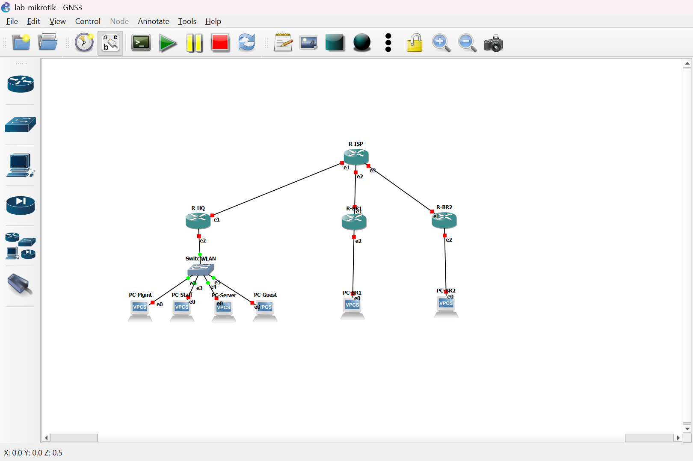

| Device | Role |
|---|---|
| R-ISP | Simulated internet provider |
| R-HQ | Headquarters router, gateway for VLANs 10/20/30/40 |
| R-BR1, R-BR2 | Branch routers |
| SwitchVLAN | GNS3 Ethernet switch, trunk to R-HQ and access ports per VLAN |
| PC-Mgmt, PC-Staff, PC-Server, PC-Guest | VPCS clients, one per HQ VLAN |
| PC-BR1, PC-BR2 | VPCS clients at the branches |

## Tools

- GNS3 2.2.61 with GNS3 VM on VirtualBox
- MikroTik RouterOS CHR 7.23.8
- VPCS for client simulation

## Addressing

Full tables are in [`docs/ip-plan.md`](docs/ip-plan.md) and [`docs/vlan-plan.md`](docs/vlan-plan.md).

| VLAN | Name | Network |
|---|---|---|
| 10 | Management | 10.10.10.0/24 |
| 20 | Staff | 10.10.20.0/24 |
| 30 | Server | 10.10.30.0/24 |
| 40 | Guest | 10.10.40.0/24 |

WAN links between R-ISP and each site use /30 subnets from 203.0.113.0/24 (documentation range, RFC 5737).

## What is implemented

### Layer 2 and VLANs
The switch trunks all VLANs to R-HQ (dot1q) and places each client on an access port.

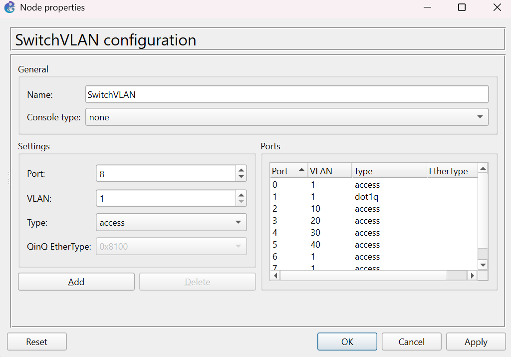

R-HQ routes between VLANs with one VLAN interface per VLAN (router-on-a-stick).

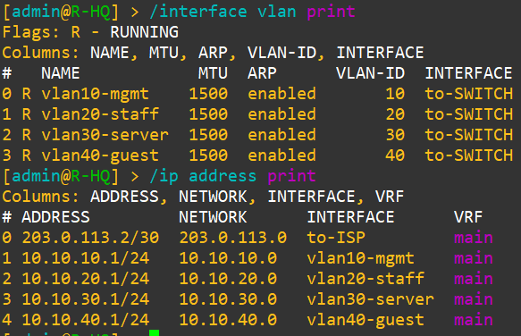

### WAN connectivity
Router links were verified with `ping` and by checking which interfaces are running.

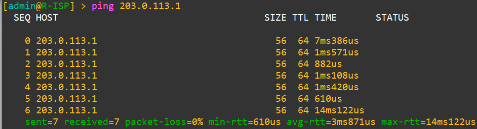
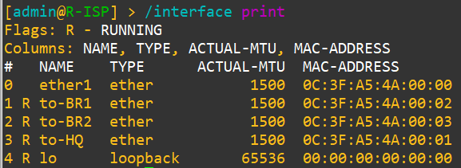

### DHCP
Each VLAN has its own DHCP server and pool on R-HQ.

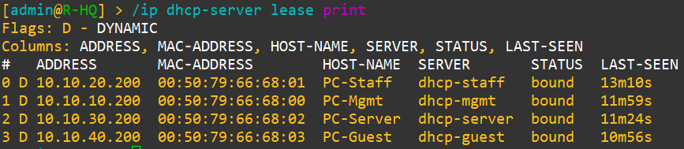
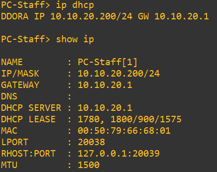

### NAT and internet access
R-HQ masquerades private traffic toward R-ISP, so VLAN clients can reach the simulated internet.

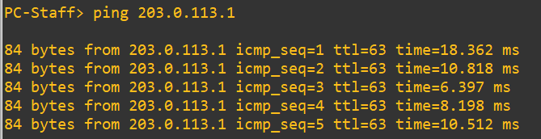

### Firewall policy
Inter-VLAN traffic is controlled on R-HQ. Management can reach every VLAN, Staff can reach Server, and every other inter-VLAN flow is dropped. Internet access stays open for all VLANs.

Guest to Staff is blocked:

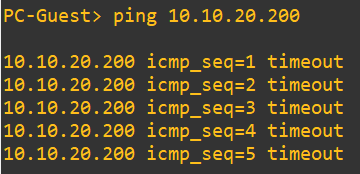

Staff to Server is allowed:

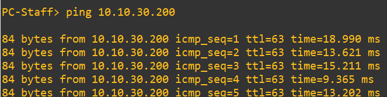

Rules on R-HQ:

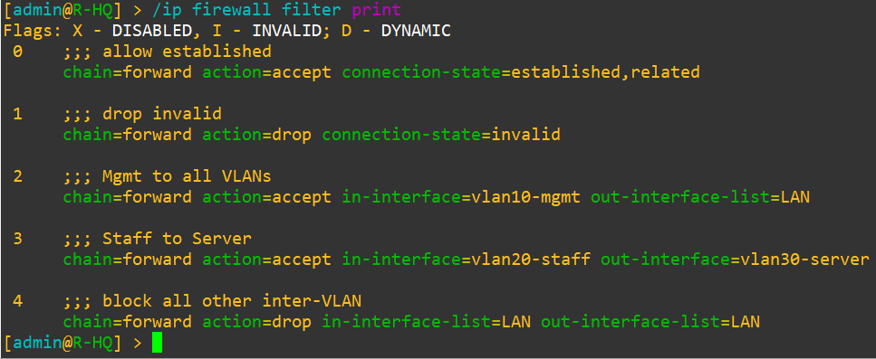

Test summary: [`docs/test-results.md`](docs/test-results.md).

## Repository layout

```
configs/   RouterOS exports (.rsc), sensitive data hidden
docs/      IP plan, VLAN plan, test results
images/    Screenshots used in this README
troubleshooting.md
```

## Reproducing the lab

1. Install GNS3 and the GNS3 VM (same version), then add a MikroTik CHR image as a QEMU template.
2. Build the topology shown above and cable it according to [`docs/ip-plan.md`](docs/ip-plan.md).
3. Verify which RouterOS interface is connected to each link (`/interface print`, `/ip neighbor print`); port names do not always follow GNS3 adapter order.
4. Import the configuration of each router from `configs/` (`/import file-name=r-hq.rsc`).

## Project status

- [x] Phase 1: HQ with VLANs, inter-VLAN routing, DHCP, NAT, firewall
- [ ] Phase 1: Branch routers (DHCP, NAT) and branch connectivity
- [ ] Phase 2: OSPF, BGP toward the ISP, site-to-site VPN, failover, QoS
- [ ] Phase 3: SNMP monitoring with Zabbix (see [zabbix-vm-noc-lab](https://github.com/nurhiddayah312/zabbix-vm-noc-lab)), configuration backup automation

## Known limitations

- The firewall filters the `forward` chain only. Access to the router itself from the Guest VLAN is not hardened yet.
- Tests use ICMP only.
- Branches cannot reach each other or HQ until Phase 2.

## Problems encountered

See [`troubleshooting.md`](troubleshooting.md).
