# MikroTik Multi-Site Network Lab (GNS3)

A multi-site enterprise network built with MikroTik RouterOS (CHR) in GNS3: one headquarters with four VLANs, two branch offices, and a simulated ISP. The lab covers the skills most often requested in junior network engineer and NOC job postings: VLANs, inter-VLAN routing, DHCP, NAT, firewall policy, plus WireGuard site-to-site tunnels with OSPF between sites. Monitoring is planned next.

## Topology


| Device | Role |
|---|---|
| R-ISP | Simulated internet provider |
| R-HQ | Headquarters router, gateway for VLANs 10/20/30/40 |
| R-BR1, R-BR2 | Branch routers |
| SwitchVLAN | GNS3 Ethernet switch, trunk to R-HQ and access ports per VLAN |
| PC-Mgmt, PC-Staff, PC-Server, PC-Guest | VPCS clients, one per HQ VLAN |
| PC-BR1, PC-BR2 | VPCS clients at the branches |

## Tools

- GNS3 2.2.61 with GNS3 VM on VirtualBox
- MikroTik RouterOS CHR 7.23.8
- VPCS for client simulation

## Addressing

Full tables are in [`docs/ip-plan.md`](docs/ip-plan.md) and [`docs/vlan-plan.md`](docs/vlan-plan.md).

| VLAN | Name | Network |
|---|---|---|
| 10 | Management | 10.10.10.0/24 |
| 20 | Staff | 10.10.20.0/24 |
| 30 | Server | 10.10.30.0/24 |
| 40 | Guest | 10.10.40.0/24 |

WAN links between R-ISP and each site use /30 subnets from 203.0.113.0/24 (documentation range, RFC 5737).

## What is implemented

### Layer 2 and VLANs
The switch trunks all VLANs to R-HQ (dot1q) and places each client on an access port.


R-HQ routes between VLANs with one VLAN interface per VLAN (router-on-a-stick).


### WAN connectivity
Router links were verified with `ping` and by checking which interfaces are running.


### DHCP
Each VLAN has its own DHCP server and pool on R-HQ.


### NAT and internet access
R-HQ masquerades private traffic toward R-ISP, so VLAN clients can reach the simulated internet.


### Firewall policy
Inter-VLAN traffic is controlled on R-HQ. Management can reach every VLAN, Staff can reach Server, and every other inter-VLAN flow is dropped. Internet access stays open for all VLANs.

Guest to Staff is blocked:


Staff to Server is allowed:


Rules on R-HQ:


### Branch sites
Each branch router provides DHCP and NAT for its own LAN.

BR1 client lease and internet access:

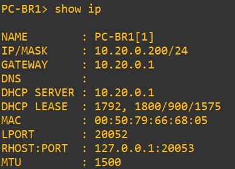
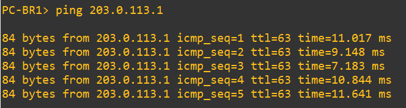

Without a path between sites, BR1 cannot reach HQ. R-ISP answers "network unreachable" because it has no route to private networks, which is the motivation for Phase 2:

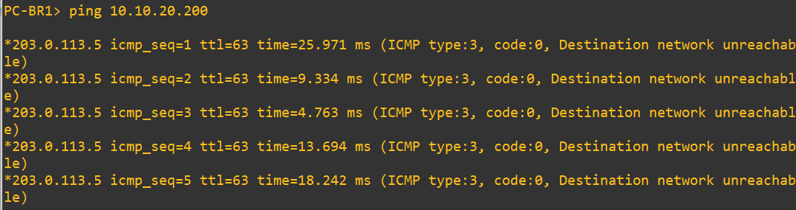

BR2 follows the same design:

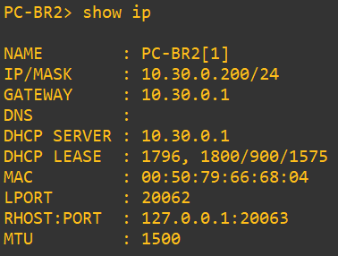
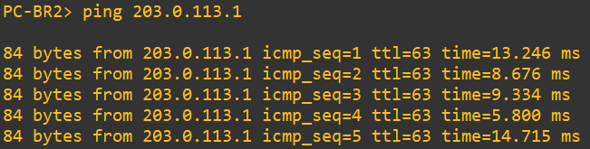
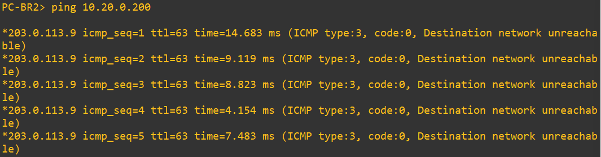

Test summary: [`docs/test-results.md`](docs/test-results.md).

### Phase 2: site-to-site VPN, OSPF and site policy

The branches could not reach HQ in Phase 1, because R-ISP knows nothing about private networks (as a real ISP would). Phase 2 connects the sites with WireGuard tunnels over the ISP and shares routes with OSPF.

- One tunnel per branch (HQ is the hub): 10.255.1.0/30 for BR1 and 10.255.2.0/30 for BR2.
- OSPF (area 0) runs over the tunnels. The Guest VLAN is deliberately not advertised.
- A `TUNNEL` interface list lets the firewall treat all branches the same way.

Tunnels are up and peers have recently completed a handshake:

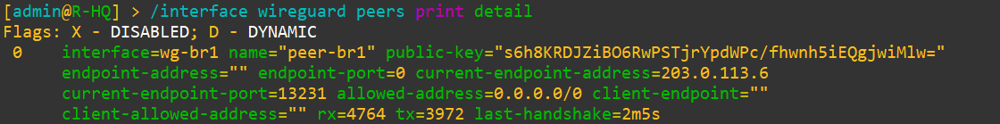
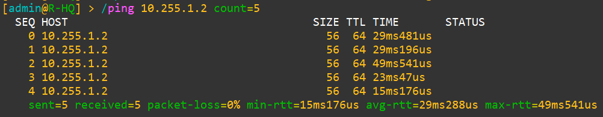

OSPF neighbors and learned routes:

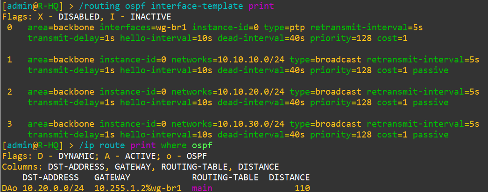
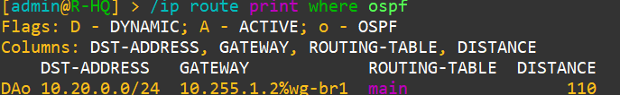

A branch can now reach HQ (this ping failed with "unreachable" in Phase 1):

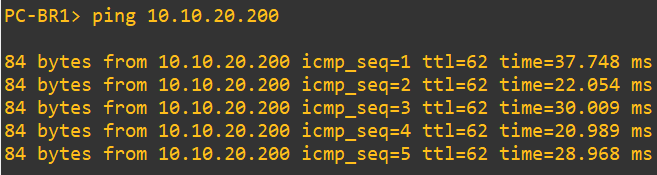

Routing alone gave a branch access to every advertised HQ VLAN, so a site policy was added on R-HQ: branches reach only the Server VLAN, HQ Management and Staff can reach the branches, and Guest cannot.

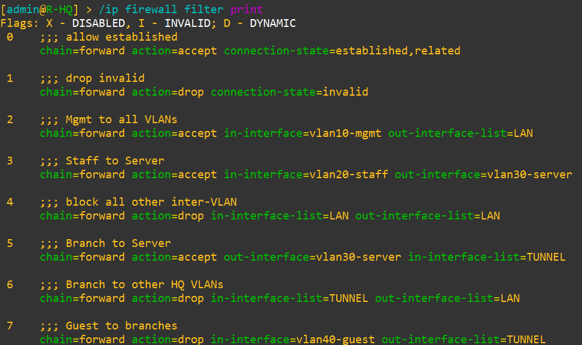
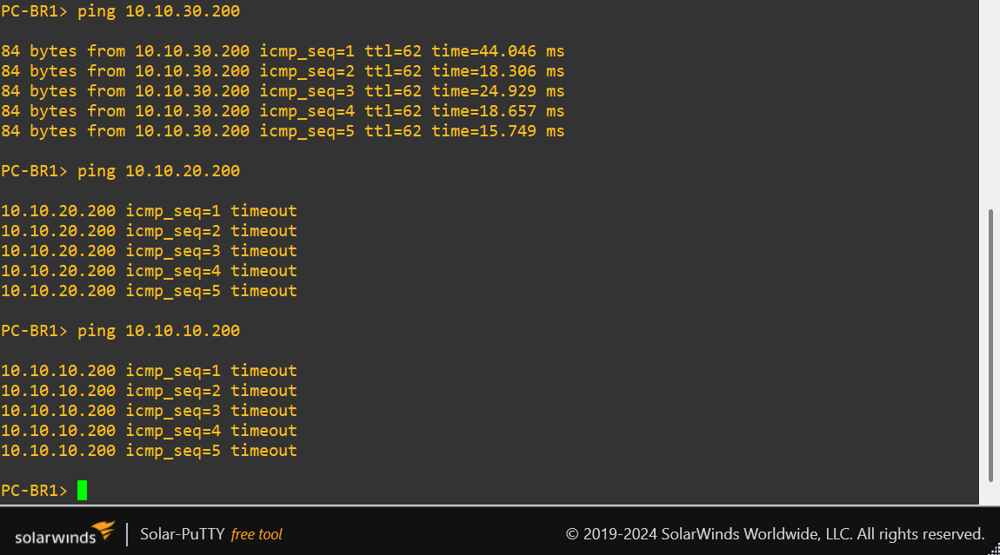

The second branch uses the same design, and traffic between branches passes through HQ:

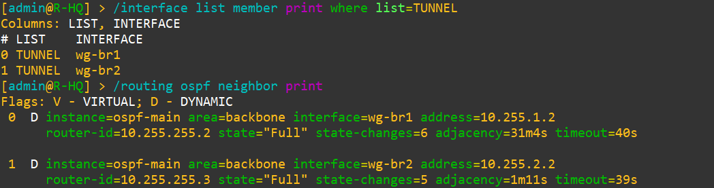
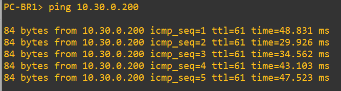

### Router hardening

Every router now drops anything addressed to it that is not explicitly allowed (WireGuard, OSPF, DHCP, limited ping, and SSH/Winbox from the Management VLAN only). Insecure services (telnet, ftp, www, api) are disabled, and the neighbor discovery and MAC access tools are turned off. The full rule list is in [`docs/hardening.md`](docs/hardening.md).

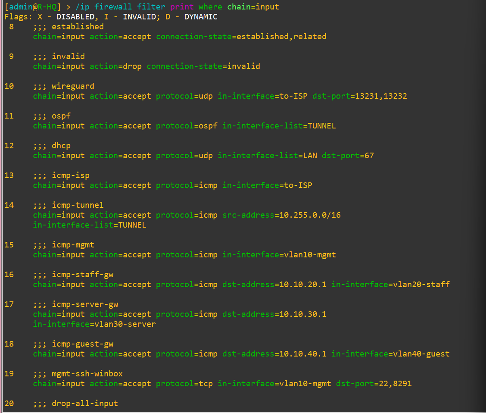
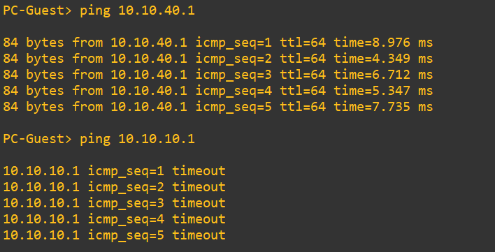
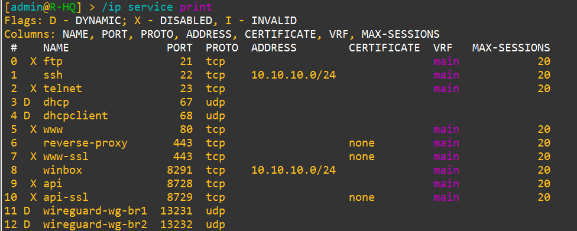

Branch routers use the same pattern, and SSH/Winbox reach them only from the HQ Management VLAN through the tunnel:

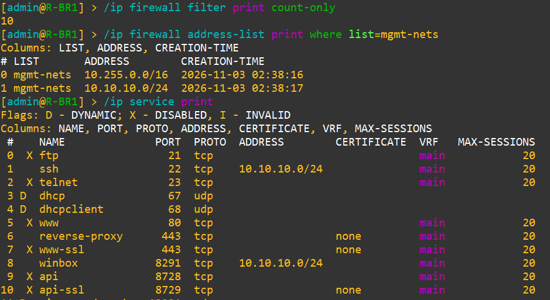
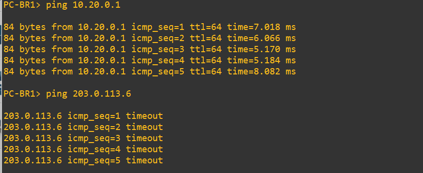

## Repository layout

```
configs/   RouterOS exports (.rsc), sensitive data hidden
docs/      IP plan, VLAN plan, test results
images/    Screenshots used in this README
troubleshooting.md
```

## Reproducing the lab

1. Install GNS3 and the GNS3 VM (same version), then add a MikroTik CHR image as a QEMU template.
2. Build the topology shown above and cable it according to [`docs/ip-plan.md`](docs/ip-plan.md).
3. Verify which RouterOS interface is connected to each link (`/interface print`, `/ip neighbor print`); port names do not always follow GNS3 adapter order.
4. Import the configuration of each router from `configs/` (`/import file-name=r-hq.rsc`).

## Project status

- [x] Phase 1: HQ with VLANs, inter-VLAN routing, DHCP, NAT, firewall
- [x] Phase 1: Branch routers (DHCP, NAT) and internet access
- [x] Phase 2: WireGuard site-to-site tunnels, OSPF, site firewall policy
- [x] Router hardening (input chain, service lockdown) on HQ and both branches
- [ ] Phase 2: BGP toward the ISP, failover, QoS
- [ ] Phase 3: SNMP monitoring with Zabbix (see [zabbix-vm-noc-lab](https://github.com/nurhiddayah312/zabbix-vm-noc-lab)), configuration backup automation

## Known limitations

- R-ISP (the simulated internet) is not hardened; the three site routers are.
- Tests use ICMP only.
- Branch-to-branch traffic passes through HQ (hub-and-spoke), and branches are not isolated from each other.

## Problems encountered

See [`troubleshooting.md`](troubleshooting.md).
